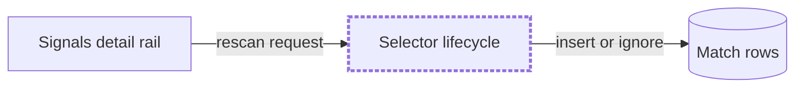

Closes #829

> [!CAUTION]
> **Merge risk: High.** The next desktop app release changes which captures a selector reports as matching.

## Summary

Adds `selectorLifecycle.rescanSelector` in selectorLifecycle.ts so an existing selector can be matched again against every capture in a case, from a
"Rescan all captures" button on the Signals detail rail. The rescan only adds matches and
never clears existing ones first, per the wave-4 intake rulings on #829. The button stays
busy until the rescan reports which selector it finished. The dispatch step opens and labels
this pull request.

Diagram

## Proof

Each acceptance criterion and what proves it

Head: `2c8c60c22a9dc92a778ef74653b7d5aa8be2ee4c`. Merge gate: pending.

| Acceptance criterion | Proof | Result |
| :-- | :-- | :-- |
| Rescan matches every capture in the case | `selectorLifecycle.test.ts` rescan case | pass |
| Existing matches are never cleared | `selectorLifecycle.test.ts` insert-or-ignore case | pass |

## Screenshots

- Visual changes: Yes
- Before, Signals detail rail: 
- After, Signals detail rail: 

## Blast radius

- On merge: the next desktop app release carries the new button and the rescan.
- If wrong: matches could be missed for a case, and reverting this pull request removes the button.

## Changes

Files changed, grouped by purpose

| Area | What changed | Why |
| :-- | :-- | :-- |
| `src/main/services/selectorLifecycle.ts`, `src/main/ipcHandlers.ts`, `src/shared/ipc.ts` | the rescan pass and its channel | the main process owns matching |
| `src/renderer/components/signals/SignalDetailRail.tsx`, `useSelectorRescan.ts` | the button and its busy state | the rail is where a selector is reviewed |
| `tests/main/services/selectorLifecycle.test.ts`, `tests/components/SignalDetailRail.test.tsx` | known-answer and rail tests | pins the insert-only rule |

## Evidence-affecting

Yes

What could change for evidence, and how that is checked

### Evidence impact

- Evidentiary result or interpretation that could change: which captures a selector reports as matching.
- What verification proves and does not prove after this change: match rows remain insert-or-ignore; no existing row is removed.
- Backward verification preserved (existing evidence packages still verify): yes, no manifest or hash path is touched.
- Known-answer test added or extended, or why none applies: `selectorLifecycle.test.ts` pins the window gap.

<!-- preflight v1 sha=2c8c60c22a9dc92a778ef74653b7d5aa8be2ee4c status=pass -->
## Verification

All pre-merge checks passed

`pnpm preflight` at `2c8c60c22a9dc92a778ef74653b7d5aa8be2ee4c` on Node v20.20.2; diff scored against `origin/main` (merge base `0b48d79fc`). Result: **pass**.

- `pnpm lint` - pass (exit 0)
- `pnpm typecheck` - pass (exit 0)
- `pnpm build` - pass (exit 0)
- `pnpm build:extension` - skipped - no extension/ changes
- `pnpm test:coverage` - pass (exit 0) - 3648 passed, 8 skipped (3656), thresholds met
- `pnpm coverage:diff` - pass (exit 0) - 94.1% of changed lines covered

Pull request description generated by Claude Code
