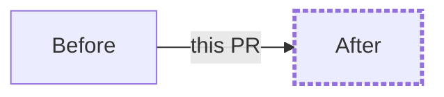

Closes #N
<!-- Or "No issue: <reason>" when there is no issue to close. -->

<!-- The Merge risk notice: a GitHub alert whose colour is the level. CAUTION for High, WARNING
for Medium, NOTE for Low, TIP for Minimal; the post-pr-body skill defines each level. The second
line names the level in bold, then says in plain words what merging ships. The lines below
claim no level, so an unfilled body fails the check. -->
> **Merge risk:** not set yet.

## Summary

<!-- At most 5 plain-language sentences: what changed, why, and any handoff (who opens or
labels the PR). No code spans, file names, commit ids or tool names here; a reader outside the
repository must follow it. The merge copies this section, up to the Diagram block, into the
squash-merge commit. -->

Diagram

<!-- Optional: use when the change alters a flow, a call sequence, a state machine or a
dependency. Draw the state after the merge in Mermaid, at most about 15 nodes, every edge
labelled, and mark what this PR changed with the changed class. Delete the block when nothing
changed that a diagram could show. -->

## Proof

Each acceptance criterion and what proves it

<!-- One row per acceptance criterion of the closed issue (or per Summary claim when there is
no issue): the test, check or run that proves it at the head commit, and its result. A
criterion nothing proves is a "Not done" line, never a row. Command output belongs in the
Verification block, not here. -->

Head: `<sha>`. Merge gate: <link to the merge-gate run at head, or "pending">.

| Acceptance criterion | Proof | Result |
| :-- | :-- | :-- |
|  |  |  |

## Screenshots

<!-- Replace the bullet with either "- Visual changes: No. <reason>" explaining why the
rendered result stays the same, or "- Visual changes: Yes" followed by a Before/After pair
per screen, in this body and never only in a comment. Hidden controls, error notices and
changed values are visual changes. Use matching screen names:
- Before, capture viewer: 
- After, capture viewer: 
A local absolute PNG path is accepted before the PR exists; the merge accepts only GitHub
attachment links. See "Screenshots for visual changes" in the post-pr-body skill. -->
- Visual changes:

## Not done

<!-- Optional: one bullet per gap, skipped test, or review finding not fixed here. Delete the
section when there is none. -->

## Blast radius

<!-- "On merge:" is what merging ships: the next desktop app release, the extension, the docs
site, or repository tooling only. "If wrong:" is what breaks and how to back it out. Plain
language, one line each. -->

- On merge:
- If wrong:

## Before merge

<!-- Optional: a step beyond review and a green merge gate. One checkbox per step, naming who
owns it. Delete the section when there is none. -->

- [ ]

## After merge

<!-- Optional: a step someone owes once this merges. One checkbox per step, naming who owns
it. Delete the section when there is none. -->

- [ ]

## Changes

Files changed, grouped by purpose

| Area | What changed | Why |
| :-- | :-- | :-- |
|  |  |  |

Decisions

<!-- Optional: one row per choice a reviewer could question, graded "in production here",
"vendor-documented pattern" or "own judgment", with its source link. Delete the block when
there is none. -->

| Decision | Grade | Source |
| :-- | :-- | :-- |
|  |  |  |

## Evidence-affecting

No

<!-- Yes when the change meets the assurance-baseline definition in CONTEXT.md, quoted verbatim:
An evidence-affecting change includes acquisition, parsing, extraction, storage, hashing,
signing, trusted time, manifests, verification, redaction, export, reporting, AI analysis, and
software distribution when it can alter an evidentiary result or its interpretation.
If Yes, keep this collapsed subsection and fill every field; otherwise delete it.

What could change for evidence, and how that is checked

### Evidence impact

- Evidentiary result or interpretation that could change:
- What verification proves and does not prove after this change:
- Backward verification preserved (existing evidence packages still verify):
- Known-answer test added or extended, or why none applies:

-->

<!-- Paste .preflight/verification.md verbatim below, marker line included, generated at the
head sha under review. It already wraps the step list in a 
 block under a plain
summary line. For a PR nobody preflighted locally (dependabot, a human author), paste what
scripts/verification-from-ci.sh <n> prints instead. Nothing above this line exceeds 40
non-blank top-layer lines; collapsed lines and these comments do not count. -->
## Verification

<!-- An agent-written description ends with this line, uncommented and last:
Pull request description generated by Claude Code
A human author deletes this comment; nothing follows the Verification block. -->
